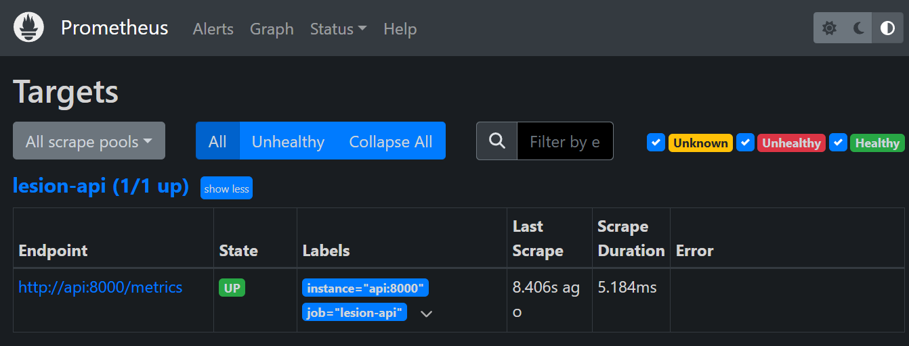
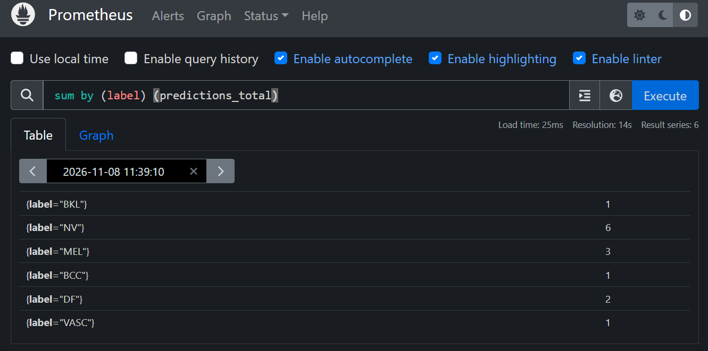
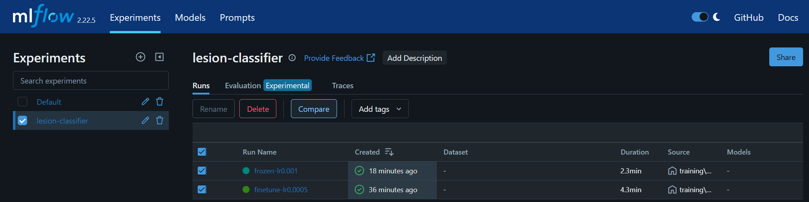
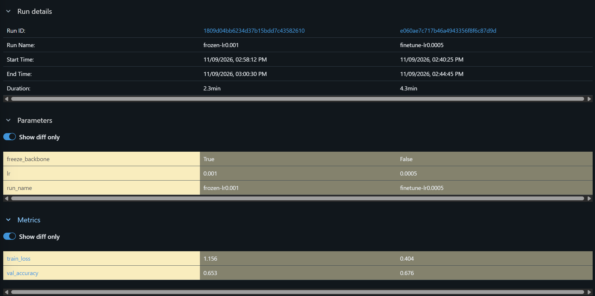
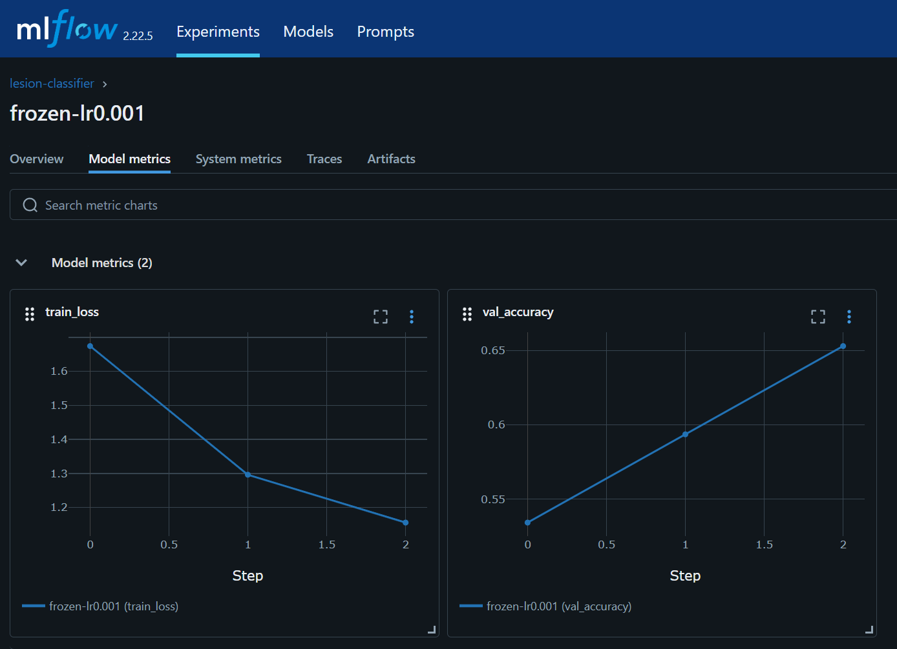

# Skin Lesion Classifier API: a small end-to-end ML deployment project

A small project that takes an image classifier from a trained model to a containerised, tested
service with basic monitoring. The model was developed for a Deep Learning subject in a Master of
Artificial Intelligence program, using the HAM10000 dataset to classify skin lesion images into
seven categories:

1. MEL – Melanoma
2. NV – Melanocytic nevus
3. BCC – Basal cell carcinoma
4. AKIEC – Actinic keratosis / Bowen's disease
5. BKL – Benign keratosis / solar lentigines
6. DF – Dermatofibroma
7. VASC – Vascular lesion

⚠️ **Medical disclaimer:** this project is for educational purposes only and is not a medical
device. Do not use it for clinical decisions, screening or diagnosis.


## What it demonstrates
- **Model serving:** FastAPI app serving a PyTorch ResNet18 with `POST /predict`, `GET /health`
  and `GET /metrics`; rejects non-image and oversized uploads.
- **Experiment tracking:** training/train.py logs hyperparameters, per-epoch loss and accuracy, and the saved model to MLflow (demonstration runs; see Experiment tracking below)
- **Testing and CI:** pytest API tests (using a stub model, so they test the service and not model
  accuracy). GitHub Actions runs linting, the tests and a Docker build on pushes to `main` and on pull requests.
- **Containerisation:** slim Python base image, CPU-only PyTorch, non-root user, healthcheck.
- **Monitoring:** Prometheus scrapes `/metrics` (requests per predicted class, latency, prediction
  confidence) through Docker Compose. A Grafana service is included in the compose file, but no
  dashboards are set up yet.

## Quick start
```bash
python3.11 -m venv .venv && source .venv/bin/activate
pip install torch torchvision --index-url https://download.pytorch.org/whl/cpu
pip install -r requirements.txt -r requirements-dev.txt
pytest -q
uvicorn app.main:app --reload
```
Without a weights file the API serves an **untrained demo model** (`/health` reports
`"model": "untrained-demo"`). Put trained weights at `models/model.pt` to use a real model.

```bash
curl -F "file=@some_image.jpg" http://localhost:8000/predict
```

## Train (CPU-friendly)
Arrange images as `data/train/<class>/*.jpg` and `data/val/<class>/*.jpg`, then:
```bash
pip install -r requirements-train.txt
python training/train.py --data-dir data --epochs 3 --subset 2000 --freeze-backbone
mlflow ui          # compare runs at http://localhost:5000
```
Data is not included (HAM10000 is available from its original sources).

## Run with Docker
```bash
docker build -t lesion-api .
docker run -p 8000:8000 -v $(pwd)/models:/srv/models:ro lesion-api
# or the full stack with Prometheus (9090) and Grafana (3000):
docker compose up --build
```
## Verification and monitoring
The model used for verification, and served by the API, is the ResNet18 from the assignment training run
(weighted sampler and weighted loss for class imbalance, data augmentation, full fine-tuning).

- **Check against the notebook:** `scripts/check_api.py` sends 14 selected validation images (a mix of
  classes, including several the model misclassifies) to the API. The predicted class matched the
  training notebook's on all 14, and the confidence scores matched to three decimal places on the 9
  images where the notebook's probabilities had been recorded. This was run locally and inside the
  Docker container. It is a spot check, not a full evaluation.

- **Prometheus:** the Targets page shows the API as UP


- **Prometheus:** The query `sum by (label) (predictions_total)`
  shows the predictions per class after the 14 images were sent.




## Experiment tracking
`training/train.py` is a smaller demonstration script used for MLflow tracking. It trains a ResNet18 on a
small subset (about 1,200 training images, 219 validation images) and logs parameters, per-epoch loss and
accuracy, and the model file. It has no augmentation or class-imbalance handling, so its results are not
comparable with the served model, which came from the assignment training run described above.

Two example runs are compared below (frozen backbone vs full fine-tune).



Run comparison:



Per-epoch loss and accuracy for the frozen-backbone run:



## Limitations / next steps
- The assignment training code that produced the served model is not included in this repository;
  `training/train.py` is a simpler demonstration script. A next step would be to move the assignment's
  imbalance handling and augmentation into it, so the served model can be reproduced and tracked end to end.
- Monitoring covers service and confidence metrics; there is no data-drift detection yet.
- No authentication, model registry or deployment to a cluster yet.
